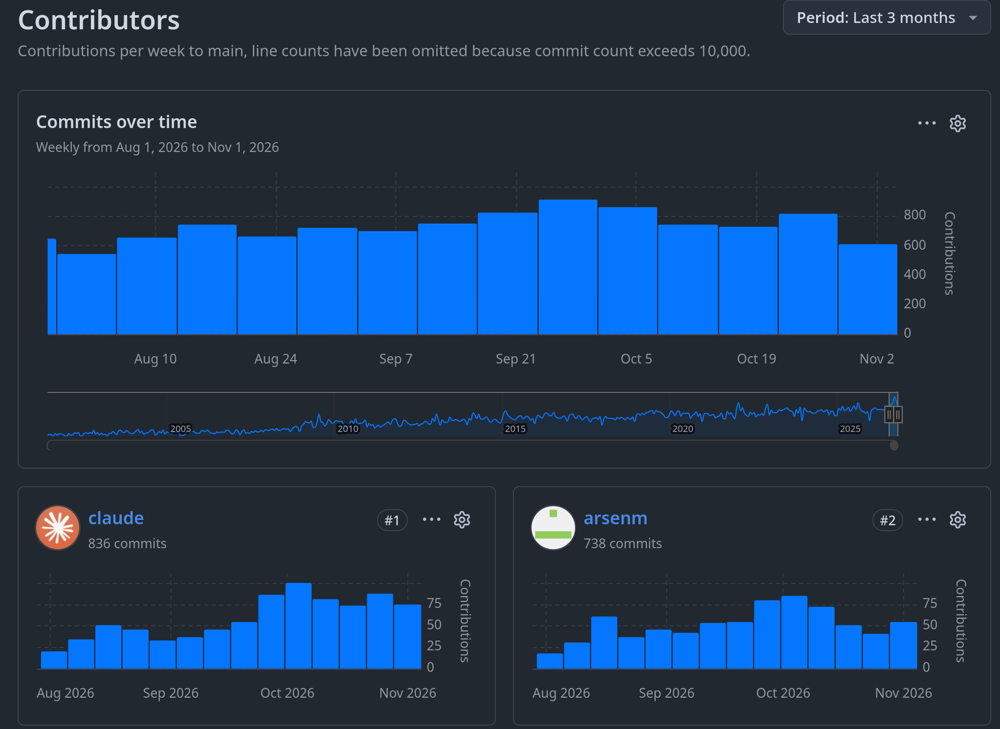
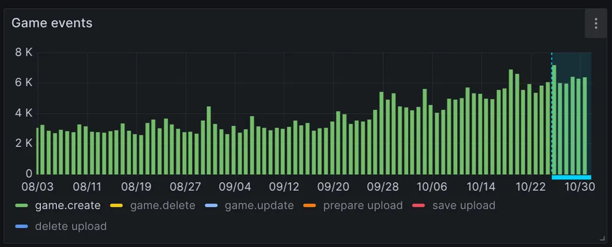

If you keep up with any kind of news as a Computer Scientist there is absolutely no way of getting around the topic of LLMs and while that is a topic I have ranted about in the past both [from the perspective of a FOSS Maintainer](/ramblings/reviewing_ai_sucks/) and [as an individual](/ramblings/is_ai_supposed_to_replace_me/). Ultimately this is a topic that is absolutely impossible to quantify within a single blog post, however, I at least want to try to mention some of the very direct consequences we have had to experience.

Looking back at these posts is kinda nostalgic because while I do think that the FOSS Maintainer perspective still lines up from the few maintainers for infinite contributors problem, so much has changed over these few months that the information feels outdated.

When I wrote the rambling about my personal experience with AI in April of this year companies did their very first trial vibecode projects such as Vinext [^vinext] or Anthropics C Compiler [^ant_c], which in my mind feel like projects that were years ago at this point.
Though just to make myself clear, I still believe that using AI for writing, art or any other creative and human endeavour is highly questionable.
At the time some of the very first LLM-assisted Pull Requests landed in a project I maintain and the low quality of them felt fairly lackluster and Vinext was full of security problems.

## Industry Shifting

### Linux, LLVM and everything you use

This has, without a doubt, completely changed in recent months.
The entire field of Computer Science has drastically **accelerated** towards LLM-assistance to a degree that felt unfathomable a year ago. Linux dropped the `Assisted-by:` commit tag [^assisted_by] with Linus Torvalds critizing refusal of AI, comparing it to usage of programming languages or text editors [^linus_ai].

LLVM, one of the most trusted and critical projects for the entire field, has Claude as the biggest contributor account on Github over the last 3 months [^llvm_contributors]. Even in the project I help to maintain, which I would have personally called fairly AI-skeptic in the grand scheme of things, AI adoption has drastically **accelerated**.

### FOSS Maintaining

In June when first adopting a proper AI Policy we started tracking AI usage to get a better picture (and so I could make a talk out of it 😉), June was the first month with major AI usage, mostly driven by a few authors experimenting with AI help for simple boilerplate "find instances where this is happens then tag them". Around June/July Claude Opus 5 and Sonnet 5 launched, marking a fairly major jump in programming capabilities, at the same time the first PRs with higher AI involvment (declared "Co-Authored" and "Vibed") started showing up, growing steadily since then with a fairly massive jump in October.

At this point more PRs involving AI usage get created than without, nearly every contributor has used AI to some degree in some PR and the amount of time spent on reviewing AI PRs has normalized to a similar degree that non-AI PRs would have taken.

This is neither a pro nor contra argument in this instance but more-so another indicator of how drastic this cultural shift and AI adoption *acceleration* within the industry has become.
In May 2026 I wrote about my [initial frustration](/ramblings/reviewing_ai_sucks/) with slopped PRs, however, through this said *acceleration* opinions raised half a year ago feel utterly outdated.
I have blog posts that are at this point 6+ years old and yet when looking back at them some of the information and my own technical understanding of software development has changed but the content generally remained pretty aligned with reality, yet here I feel like there was the biggest contrast yet for the aforementioned reasons.

### Game Release Explosion

[Image from itch.io post [^itchio_bsky]]

Itch.io, a marketplace for most indie and general game related things, recently reported that their game page creation rate __doubled__ within 2 months [^itchio_bsky], this generally coincides with the stats we previously talked about.

I deeply respect the passion and drive behind game development and it feels like it is basically every developers dream to one day create a game.
However, creating games is actually a combination of some of the hardest challenges in computer science, both in the sense that a general game engine requires a lot of mathematical understanding but also a lot of creativity for design, art and music to create a coherent experience.

If you ever participated in a game jam you will know that 72 hours of sweat and tears do not produce your exact dream game, yet it is a truly magical experience to see _something_ working on your screen.

 [Image edited from Pixar, The Incredibles [^incredibles_quote]]

AI enables people to skip most of the sweat and tears and the relatively high barrier of entry, even with game engines in mind, drastically lowers. Everyone can create *a game*, the problem is that ... who actually wants to play this? We see this massive *acceleration* in games created and released causes a market that was already way too crowded to just be crushed.

Another example for that is the Steam Next Fest, a showcase of upcoming games, which had a similar doubling from the June Next Fest to the October Next Fest to 8011 demos [^steam_next_fest]. These preexisting and already at their limits systems are not withstanding this complete *acceleration* and fundamentally just making it even harder for good indie games to stand out.

## Security is Dead

I think it's no secret that LLMs are extremely good at doing very mindless and at times random needle in the haystack finding. If you watched any news coverage in the recent weeks the speed at which critical security flaws are found in essential computer libraries and software is completely unfathomable.

### Linux Kernel CVE Amount

### Curl & Project Security Reports

While linux has met this increase in security reports with simply throwing CVEs at everything no matter what, curl has decided to go with a different approach that feels more realistic for most modern FOSS projects, every security report that they receive that rates as a low or medium severity is asked to simply reopen as a public github issue.

What would have felt insane a few months ago has become the reality of dealing with this infinite security advisory wave, realistically if you want to find exploits in most FOSS projects, you will.
Whereas this was something you would have to do with enough skill and time in the before times, it has now become something that with enough tokens, anyone can realistically do.
Both OpenAI and Anthropic provide fairly generous token and model access to security researchers which, if you read the details about incidents such as PHP or Java, is usually the way these bugs are found.

However, esp. in smaller FOSS projects or for less critical exploits, a simple normal subscription to their subsidized subscription plans suffices. In the project I help maintain we have seen an unprecedented wave of low to medium severity security reports which we are simply not able to meet.
While it aged a bit due to the aforementioned *acceleration*, [my rambling post about reviewing AI code](/ramblings/reviewing_ai_sucks/) explained this few maintainer for infinite contributors struggle pretty well.
The TLDR is that FOSS projects live on the backs of a minor group of people that are willing to spend their, usually hobby freetime, on keeping the project alive, expecting the massive amount of work into getting new contributors accustomed to a project, to span into future maintainers.

Since LLMs are enabling beginners to create massive PRs that would have taken a few months to create in minutes, it is making the process of reviewing and adopting new contributors into a project even harder while it is also becoming easier to create very specialized custom solutions intended for nobody but yourself. 
Thus FOSS maintainers experience both a massive increase in reviewing work, a decrease in community engagement and a massive increase in security reports, stretching already thinly spread maintainers to their limits.

This is a problem that is not going away and will only get worse with time, especially as LLMs become more and more capable. In my eyes this fundamentally breaks the already fragile FOSS ecosystem.

## Switch 2 Exploit

While I decided to discard all writing about other exploits in the wild due to the aforementioned constant news cycle that makes it impossible to keep and stay relevant, I do want to quickly at least mention one of the exploits that I personally thought was fairly significant even if something like the PHP exploit outcompetes it on a greater societal level.

As a small backstory, the Switch 1 was hacked due to a massive oversight by Nvidia, allowing unsigned payloads to be launched in the recovery mode of the console, something that could not be fixed through a simple firmware update but requires a complete console revision[^fusee_announced]. 
This allowed for a massive homebrew scene to develop on the Switch 1, from emulators to full linux distros running on the console.

Nintendo has been known for fairly foolish security issues in their consoles but aside from this major issue the Nintendo Switch was actually made with a fairly competent security architecture. Over the lifespan of the console we also saw Nintendo drastically improving their mistakes both on the hardware and software level, early firmware updates already patched some of the last major holes left in their architecture.

Since the Switch 2 builds upon these years of learned lessons it arrived on a fairly hardened software stack and this time Nvidia also didn't make foolish mistakes.
The console was generally perceived to be "unhackable", as in, there was no expectation of a proper homebrew scene to develop for quite some while.

And .... that still kinda holds true.

On the 21.10.2026 Sammy Hajhamid together with OpenAI LLMs that they gave a Switch 1, Switch 2, controllers and the ability to turn the console on and off, found the first public Switch 2 exploit so far[^switch2_jailbreak].
Initially the public understanding about this was that this was a fairly vibed exploit, though he later clarified that the exploit itself did actually take 2 weeks of fairly involved reverse engineering.

The exploit, compared to exploits on the Switch 1, didn't get access into the deeper functionality of the system, however, it did manage to get access to the `fs` sysmodule, a fairly impressive feat.

At the time of writing the exploit has been fixed by Nintendo[^switch_2_exploit_fixed] and the capabilities it did bring are slowly bringing a tiny homebrew ecosystem to the console even if nowhere as capable as it was on the Switch 1.

The biggest and yet probably most contentious point this exploit allowed is the dumping of Switch 2 games which has caused one of the most frightening showcases of this new LLM powered world through rapid development of recompilations and emulations projects for these games.

### Recompilation / Emulation

This blog post took so long to write down that while I am writing this people with way too much money are trying to recompile GTA 6 from the leaked Xbox Build[^gta_6_sues]. While their process is still slow considering the immense size and complexity of GTA 6, they are currently already able to show menus. These are for the most part not experts, these are in part literal students:

A similar thing happened when the Switch 2 hack allowed to dumping of Switch 2 games. Within hours somebody managed to get Mario Kart World emulated by vibecoding a continuation of a Nintendo Switch 1 emulator Nintendo took down[^mario_kart_emu].

That by itself felt fairly impressive already even when Mario Kart Worlds origin as a Nintendo Switch 1 title together with the existing emulator for the Switch 1 eased the process of getting it running. A more impressive showcase was what happened to Ocarina of Time, on the same day it released a recompilation of the game got released. At first it ran with fairly severe stutters but in the following days it managed to run at a fairly stable framerate.

This .... is fairly unprecedented. Recompilations and decompilations take an immense amount of skill and passion, or at least they used to. Examples such as the Pokemon or Animal Crossing decompilations have given us incredible understanding of the game and developers while being noteworthy hobby projects, creating communities of people that are passionate about the game and its development[^animal_crossing_shoutout]. However, this is a process that usually takes years to complete, not days.

When the decompilation of Ocarina of Time (N64, not Switch 2) got good enough to make PC ports it was a fairly big deal, I remember gaming news outlets reporting about it and the community was fairly excited about it [^oot_64_announcement]. The difference between Ocarina of Time (Switch 2) and Ocarina of Time (N64) getting decompiled couldn't be more stark.

There is a really sad but excellent send-off post by decomp.dev, one of the most well known decompilation projects shutting down because of this cultural shift, I highly recommend reading it on their site[^decomp_blog].

LLM re-/decompilations are able to get matching code [^shiny_recomp] though depending on the harness and willingness to cheat of the LLM used also simply try to appease the test suite.
What we are missing is the knowledge gained from this. Does the average gamer actually care about how they are able to get their game running or appreciate the art behind the craft or do they just want to get their game running?

With the current race to get GTA 6 running we are seeing a "get this done no matter the legality or ethics" approach. Ocarina of Time (Switch 2) and other recompilations got away with still requiring your own game dump to get the game running (at least in theory) [^oot_sue_em]. In the case of GTA 6 there is no legal dump, there is no grey zone of legality and yet people are still racing to get it running.

## Where do we go from here

One of the biggest struggles writing this blog has been that what I want to write about feels outdated on the next day, esp. around the Security section there is basically an endless onslaught of major security incidents every single day, from Java, Nginx, PHP, everything is starting to report critical security flaws at such an *accelerated* speed that it has become impossible to even process one thing before the next thing happens.

It has never been easier to get huge projects running, it has never been easier to get a game running, it has never been easier to get a security flaw found and exploited. The *acceleration* of the industry is so fast that it is impossible to keep up with it, even for people that are in the industry.
A developer can be turned into a pure review machine and speeds and efficiency that was unthinkable and yet the more valuable his work the less valuable he becomes. The more valuable his work the more he is replaceable, the more he is replaceable the less valuable he becomes. Or in other words:

The worker becomes an ever cheaper commodity the more commodities he creates.
Labour produces not only commodities,
it produces itself and the worker as a commodity -- and does so in the proportion in which it produces commodities generally. [^marx_manuscripts]

This will probably be a long list of footnotes following 🫠

[^assisted_by]: https://lore.kernel.org/lkml/20261009083137.3-1-sashal@kernel.org/ (Accessed 26.10.2026)
[^linus_ai]: https://lore.kernel.org/lkml/CAHk-=whTs09_ozN+e09GU68N1wPP56MUzDjrg9rnKxQUa0A_4Q@mail.gmail.com/ (Accessed 26.10.2026)
[^llvm_contributors]: https://github.com/llvm/llvm-project/graphs/contributors?from=8%2F1%2F2026 (Accessed 01.11.2026)
[^marx_manuscripts]: Marx, K.,The Economic and Philosophical Manuscripts; Marx/Engels Internet Archive (marxists.org) 1993
[^itchio_bsky]: https://bsky.app/profile/itch.io/post/3mz7vswlnbs23 (Accessed 02.11.2026)
[^steam_next_fest]: https://gamerant.com/steam-next-fest-october-2026-generative-ai-games/ (Accessed 10.11.2026)
[^incredibles_quote]: Pixar, The Incredibles, Image from https://www.buzzfeed.com/marycolussi/most-memorable-villain-quotes-reddit (Accessed 10.11.2026)
[^switch2_jailbreak]: https://pepsipu.com/blog/2026-10-switch2-jailbreak-ns2jb/ (Accessed 20.11.2026)
[^vinext]: https://blog.cloudflare.com/vinext/ (Accessed 24.11.2026)
[^ant_c]: https://www.anthropic.com/research/building-c-compiler (Accessed 24.11.2026)
[^oot_sue_em]: https://www.ign.com/articles/the-legend-of-zelda-ocarina-of-time-remake-is-already-running-rampant-on-pc-but-can-nintendo-do-anything-about-it (Accessed 24.11.2026)
[^oot_64_announcement]: https://www.reddit.com/r/nintendo/comments/r3b90i/zelda_ocarina_of_time_fan_decompilation_project/ (Accessed 24.11.2026)
[^gta_6_sues]: https://www.notebookcheck.net/As-GTA-6-PC-port-gets-closer-to-becoming-playable-Rockstar-is-reportedly-taking-action-against-modders-and-Discord-communities.1458181.0.html (Accessed 24.11.2026)
[^shiny_recomp]: https://github.com/shinyquagsire23/Yodecomp Not directly related but I always like seeing their experiments into how far LLMs have come for this (Accessed 24.11.2026)
[^decomp_blog]: https://decomp.dev/ (Accessed 24.11.2026)
[^animal_crossing_shoutout]: https://www.youtube.com/@Hunter-R. I feel like I have to shout him out he is like my favourite youtuber
[^mario_kart_emu]: https://www.thegamer.com/nintendo-switch-2-emulator-available-now-mario-kart-world/ (Accessed 24.11.2026)
[^fusee_announced]: https://www.bleepingcomputer.com/news/hardware/researcher-discloses-unpatchable-nintendo-switch-exploit/ (Accessed 24.11.2026)
[^switch_2_exploit_fixed]: https://opencritic.com/news/39411/nintendo-has-swiftly-patched-switch-2-jailbreak-exploit (Accessed 24.11.2026)
