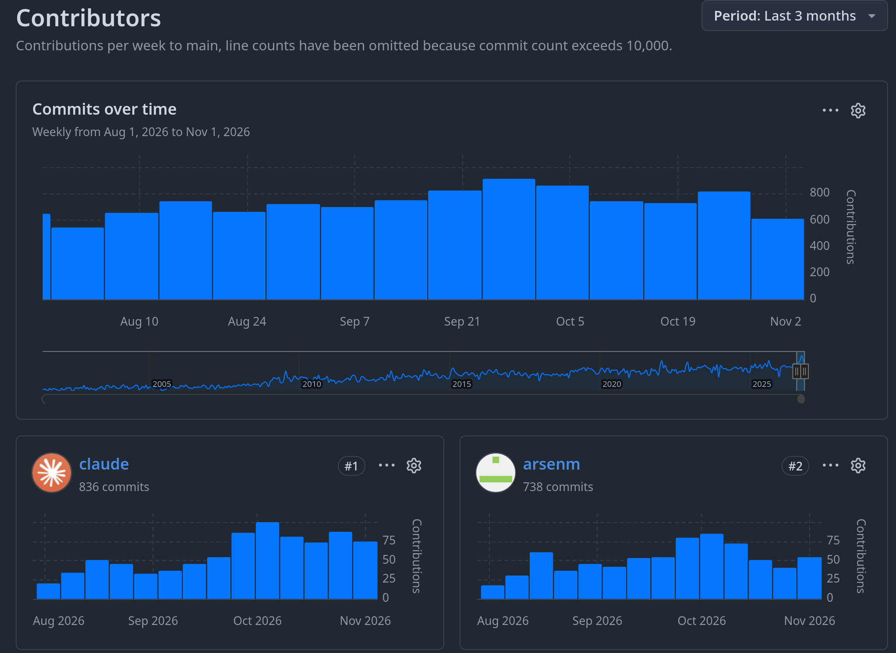
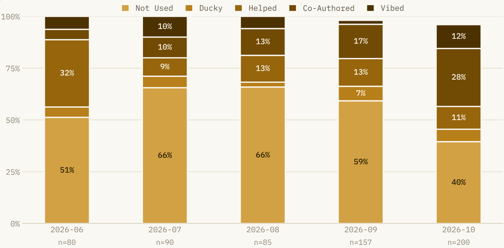
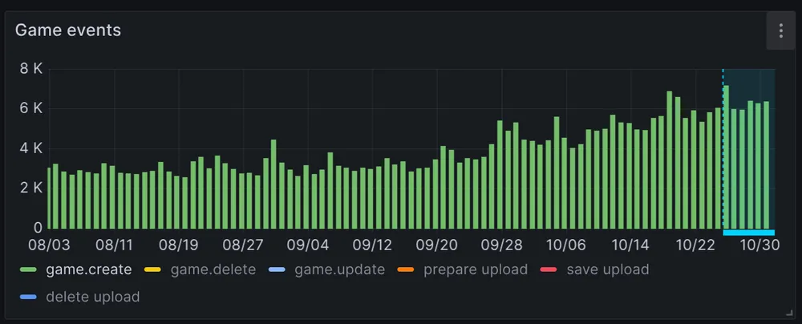

If you keep up with any kind of news as a Computer Scientist there is absolutely no way of getting around the topic of LLMs and while that is a topic I have ranted about in the past both [from the perspective of a FOSS Maintainer](/ramblings/reviewing_ai_sucks/) and [as an individual](/ramblings/is_ai_supposed_to_replace_me/). Ultimately this is a topic that is absolutely impossible to quantify within a single blog post, however, I at least want to try to mention some of the very direct consequences we have had to experience.

Looking back at these posts is kinda nostalgic because while I do think that the FOSS Maintainer perspective still lines up from the few maintainers for infinite contributors problem, so much has changed over these few months that the information feels outdated.

When I wrote the rambling about my personal experience with AI in April of this year companies did their very first trial vibecode projects such as Vinext or Anthropics C Compiler, which in my mind feel like projects that were years ago at this point.
Though just to make myself clear, I still believe that using AI for writing, art or any other creative and human endeavour is highly questionable.
At the time some of the very first LLM-assisted Pull Requests landed in a project I maintain and the low quality of them felt fairly lackluster and Vinext was full of security problems.

## Industry Shifting

### Linux, LLVM and everything you use

This has, without a doubt, completely changed in recent months.
The entire field of Computer Science has drastically **accelerated** towards LLM-assistance to a degree that felt unfathomable a year ago. Linux dropped the `Assisted-by:` commit tag [^3] with Linus Torvalds critizing refusal of AI, comparing it to usage of programming languages or text editors [^2].

LLVM, one of the most trusted and critical projects for the entire field, has Claude as the biggest contributor account on Github over the last 3 months [^1]. Even in the project I help to maintain, which I would have personally called fairly AI-skeptic in the grand scheme of things, AI adoption has drastically **accelerated**.

### FOSS Maintaining

In June when first adopting a proper AI Policy we started tracking AI usage to get a better picture (and so I could make a talk out of it 😉), June was the first month with major AI usage, mostly driven by a few authors experimenting with AI help for simple boilerplate "find instances where this is happens then tag them". Around June/July Claude Opus 5 and Sonnet 5 launched, marking a fairly major jump in programming capabilities, at the same time the first PRs with higher AI involvment (declared "Co-Authored" and "Vibed") started showing up, growing steadily since then with a fairly massive jump in October.

At this point more PRs involving AI usage get created than without, nearly every contributor has used AI to some degree in some PR and the amount of time spent on reviewing AI PRs has normalized to a similar degree that non-AI PRs would have taken.

This is neither a pro nor contra argument in this instance but more-so another indicator of how drastic this cultural shift and AI adoption *acceleration* within the industry has become.
In May 2026 I wrote about my [initial frustration](/ramblings/reviewing_ai_sucks/) with slopped PRs, however, through this said *acceleration* opinions raised half a year ago feel utterly outdated.
I have blog posts that are at this point 6+ years old and yet when looking back at them some of the information and my own technical understanding of software development has changed but the content generally remained pretty aligned with reality, yet here I feel like there was the biggest contrast yet for the aforementioned reasons.

### Game Release Explosion

[Image from itch.io post [^5]]

Itch.io, a marketplace for most indie and general game related things, recently reported that their game page creation rate __doubled__ within 2 months [^5], this generally coincides with the stats we previously talked about.

I deeply respect the passion and drive behind game development and it feels like it is basically every developers dream to one day create a game.
However, creating games is actually a combination of some of the hardest challenges in computer science, both in the sense that a general game engine requires a lot of mathematical understanding but also a lot of creativity for design, art and music to create a coherrent experience.

If you ever participated in a gamejam you will know that 72 hours of sweat and tears do not produce your exact dream game, yet it is a truly magical experience to see _something_ working on your screen.

 [Image edited from Pixar, The Incredibles [^7]]

AI enables people to skip most of the sweat and tears and the relatively high barrier of entry, even with game engines in mind, drastically lowers. Everyone can create *a game*, the problem is that ... who actually wants to play this? We see this massive *acceleration* in games created and released causes a market that was already way too crowded to just be crushed.

Another example for that is the Steam Next Fest, a showcase of upcoming games, which had a similar doubling from the June Next Fest to the October Next Fest to 8011 demos [^6]. These pre-existing and already at their limits systems are not withstanding this complete *acceleration* and fundementally just making it even harder for good indie games to stand out.

## Security is Dead

### PHP

### Linux Kernel CVE Amount

### Project Security Reports

## Switch 2 Exploit

### Recompilation / Emulation

## Where do we go from here

The worker becomes an ever cheaper commodity the more commodities he creates.
Labour produces not only commodities,
it produces itself and the worker as a commodity -- and does so in the proportion in which it produces commodities generally. [^4]

This will probably be a long list of footnotes following 🫠

[^3]: https://lore.kernel.org/lkml/20261009083137.3-1-sashal@kernel.org/ (Accessed 26.10.2026)
[^2]: https://lore.kernel.org/lkml/CAHk-=whTs09_ozN+e09GU68N1wPP56MUzDjrg9rnKxQUa0A_4Q@mail.gmail.com/ (Accessed 26.10.2026)
[^1]: https://github.com/llvm/llvm-project/graphs/contributors?from=8%2F1%2F2026 (Accessed 01.11.2026)
[^4]: Marx, K.,The Economic and Philosophical Manuscripts; Marx/Engels Internet Archive (marxists.org) 1993
[^5]: https://bsky.app/profile/itch.io/post/3mz7vswlnbs23 (Accessed 02.11.2026)
[^6]: https://gamerant.com/steam-next-fest-october-2026-generative-ai-games/ (Accessed 10.11.2026)
[^7]: Pixar, The Incredibles, Image from https://www.buzzfeed.com/marycolussi/most-memorable-villain-quotes-reddit (Accessed 10.11.2026)
